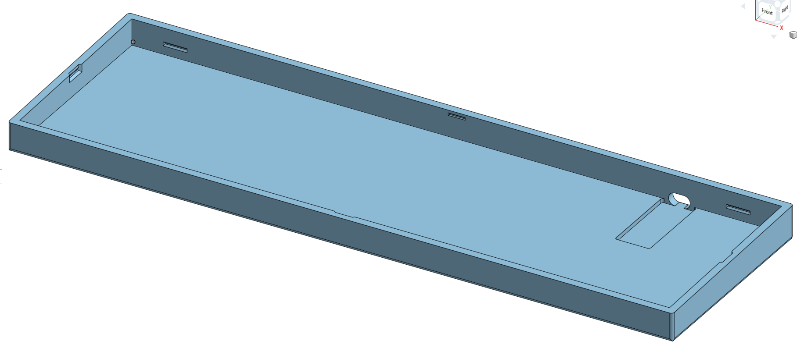
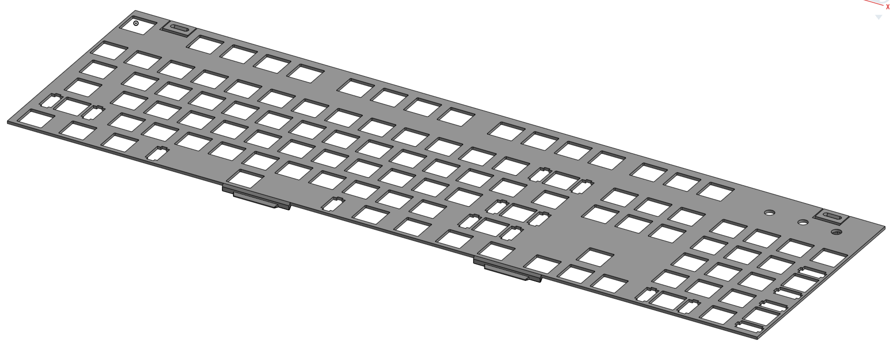
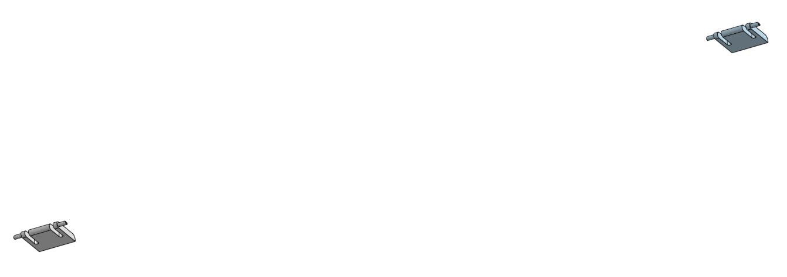

# RGB-Keyboard-Enclosure
An enclosure for the RGB Keyboard PCB I designed in Week 1 of Hack Club Half Life.

## 3d Model
I made the 3d model for the plate and enclosure for the keyboard with Onshape (Onshape link is [here](https://cad.onshape.com/documents/bef98f37e404cedfbf342dc0/w/166404571d869c1e016b182f/e/bd2b0c887cfc6ff7f177dfe3?renderMode=0&leftPanel=false&uiState=6ae8a9d4f03f46e928fddcc9)).

You can find the .step and .stl files for the Enclosure in the [CAD Files folder](https://github.com/araschke001-commits/RGB-Keyboard-Enclosure/CAD%20Files)

Border:

Plate:

Top Cover:

Extenders:

Enclosure Top:

Enclosure Bottom:

Full Assembly:

## BOM